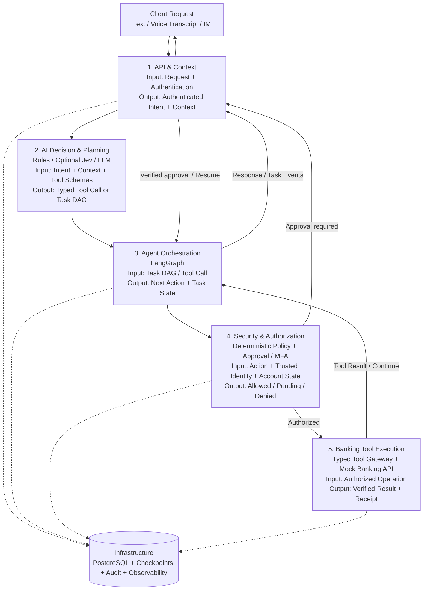

# AI Banking Agent — Backend Architecture

> **Document status:** Planned architecture (not a claim of completed implementation)  
> **Scope:** Python-only Mock Banking Core, Typed Agent Tools, and their integration with the future AI Agent  
> **Primary goals:** financial correctness, controlled tool execution, clear contracts, auditability, and rapid MVP delivery

## 1. Project Overview

The project is an AI Banking Agent that turns natural-language financial intent into controlled banking operations. The system separates **probabilistic AI decisions** from **deterministic banking execution**: an LLM may interpret and plan, but only typed tools and an authorized Banking Core may access or change financial state.

Competition scenarios include transfers, bill analysis, wealth management, card management, subscriptions, and cross-scenario orchestration. The first MVP prioritizes **balance/transaction queries, secure simulated transfers, and subscription/bill analysis**.

**Out of scope for the initial Banking Core build:** frontend UI, speech recognition, Jev benchmarking, and implementation of the LangGraph planner. Interfaces must nevertheless be designed to support those additions without rewriting the core.

## 2. High-Level Architecture

The backend is organized as **five functional modules plus cross-cutting infrastructure**.



> This is a **logical diagram**, not a claim that every request calls every component. Simple, clearly recognized read-only requests may bypass the LLM planner. **All accesses still require authorization**, and **every state-changing Banking API endpoint must enforce security independently** of the Agent layer. Approval arrives through an authenticated server endpoint, not as a trusted client-supplied boolean.

## 3. Modules, Responsibilities & Contracts

| Module | Core responsibilities | Input | Output | Technology |
|---|---|---|---|---|
| **1. API & Context** | Request validation, authenticated identity, sessions, task status, event streaming | JSON request, verified credentials | `AgentRequest`, trusted context, task/event references | FastAPI, Pydantic v2, SSE |
| **2. AI Decision & Planning** | Intent routing, context-aware task decomposition, typed plans | User intent, permitted context, tool schemas | `TaskPlan` or simple `ToolCall` | LLM API, optional Jev, Pydantic |
| **3. Agent Orchestration** | Dependency scheduling, checkpoints, interrupt/resume, bounded retry | Validated DAG, tool results | `NextAction`, `TaskState`, events | LangGraph, PostgreSQL checkpointer |
| **4. Security & Authorization** | Ownership, risk tier, limits, confirmation/MFA, lockout, approval binding | Trusted actor, operation, server-side balances/limits | `PolicyDecision`, approval state, execution authorization | Python policies, PostgreSQL |
| **5. Banking Tool Execution** | Schema validation, tool registry, authorized API calls, idempotent financial operations | Typed tool arguments + trusted `ExecutionContext` | `ToolResult`, persisted transaction + receipt | Python, HTTPX, FastAPI, SQLAlchemy |
| **Infrastructure** | Source-of-truth persistence, audit, observability, migration, tests | Domain events and state updates | Durable records, traces, recoverable state | PostgreSQL, Alembic, pytest, OpenTelemetry (later) |

### Module 5 internal boundary

```text
Future LangGraph Agent
        |
        v
Typed Tool Registry / Gateway  (Python; input/output Pydantic models)
        |
        v
Banking API Client            (HTTPX; REST + JSON)
        |
        v
Mock Banking Core             (FastAPI -> Services -> Repositories)
        |
        v
PostgreSQL                    (accounts, ledger, approvals, audit)
```

The **Agent Tools never access ORM repositories directly**. The **Banking Core owns financial state**, rechecks all authorization, and is independently callable and testable without an AI model. The Agent and Banking Core may run as separate Python processes from the start; this keeps the service boundary replaceable.

## 4. Technology Stack

| Area | MVP choice | Notes |
|---|---|---|
| Language | Python 3.11+ | One language across Banking Core and Agent tools |
| Banking HTTP API | FastAPI | Small route handlers; business logic stays in services |
| Data contracts | Pydantic v2, Python typing, `Enum`/`StrEnum` | Domain objects, API schemas, and ORM models remain separate |
| Database access | SQLAlchemy 2.x | Transaction boundaries in service layer |
| Source-of-truth database | PostgreSQL | ACID, row locks, constraints, ledger, approvals and audit |
| Schema migrations | Alembic | Version all schema changes |
| Tool-to-bank client | HTTPX async client | Timeouts, error mapping, trace propagation |
| Agent workflow (integration phase) | LangGraph | DAG execution, checkpointing, human-in-the-loop |
| LLM (integration phase) | Configurable model provider | Structured outputs; no privileged DB access |
| Jev (optional optimization) | Pluggable intent router | Add only after baseline and benchmark |
| Cache / rate limit (optional) | Redis | Not required to make transfers transaction-safe |
| Tests / quality | pytest, pytest-asyncio, Ruff, mypy | Include real PostgreSQL concurrency tests |
| Deployment | Docker Compose | Banking API + PostgreSQL; tools can be a Python package |

Avoid C++ bindings, gRPC, Kafka, Kubernetes, vector databases, or multiple orchestration engines during the MVP.

## 5. Code Organization

```text
banking-agent-backend/
├── banking_core/
│   └── app/
│       ├── api/             # HTTP routes and dependencies
│       ├── domain/          # Domain entities, Money, enums, invariants
│       ├── schemas/         # Pydantic API request/response contracts
│       ├── services/        # Accounts, transfers, ledger, bills, etc.
│       ├── persistence/     # SQLAlchemy ORM, repositories, DB sessions
│       ├── security/        # Identity, policy, approvals, mock MFA, audit
│       ├── config.py
│       └── main.py
├── agent_tools/
│   ├── base.py              # Generic typed tool interface
│   ├── context.py           # Trusted ExecutionContext
│   ├── registry.py          # Tool registration/discovery
│   ├── gateway.py           # Validation, enforcement, result envelope
│   ├── client.py            # Async HTTPX Banking API client
│   └── tools/               # Account, transfer, bill, etc. tool adapters
├── shared/                  # Stable cross-component enums/contracts
├── tests/
│   ├── unit/
│   ├── integration/
│   ├── concurrency/
│   └── security/
├── scripts/                 # Deterministic seeds and demo tool calls
├── alembic/
├── docs/
├── AGENTS.md
├── pyproject.toml
├── docker-compose.yml
└── README.md
```

**Layer rules:**

- `api -> services -> domain/repositories`; route handlers do not contain banking business logic.
- `agent_tools -> Banking API over HTTP`; tools cannot import Banking Core repositories.
- `security` is enforced **inside** the Banking Core even if the Agent gateway already checked the request.
- ORM objects, domain entities, and public schemas are separate models with explicit mappings.
- Replaceable clients/services use dependency injection and `Protocol` or minimal abstract interfaces.

## 6. Stable Data Contracts

Use **JSON** for HTTP request/response bodies, **SSE with JSON payloads** for task progress, and **JSONL** for offline benchmark/export datasets—not ordinary frontend API requests.

| Contract | Produced by | Used by | Essential content |
|---|---|---|---|
| `AgentRequest` | Client/API | Agent entrypoint | request ID, session ID, message, channel |
| `ExecutionContext` | Trusted server | Tool Gateway / Core | authenticated actor, session/task/trace IDs, approval reference |
| `ToolCall[InputT]` | Planner | Tool Gateway | allowed tool name, typed arguments; **no trusted identity or risk tier** |
| `TaskPlan` | LLM Planner | Plan validator / LangGraph | task goal, step IDs, dependencies, validated arguments |
| `PolicyDecision` | Deterministic security service | Workflow / Core | risk tier, allow/pending/deny, reason, approval reference |
| `ToolResult[OutputT]` | Tool Gateway | Workflow / client events | status, typed result or safe error, trace ID |
| `AgentEvent` | Orchestrator | SSE frontend | `task.planned`, `step.completed`, `task.waiting_approval`, etc. |

### Suggested result statuses

`SUCCESS`, `WAITING_APPROVAL`, `MFA_REQUIRED`, `DENIED`, `VALIDATION_ERROR`, `EXECUTION_ERROR`.

An approval wait is **not** an execution failure or success. Money must be represented by Python `Decimal`, PostgreSQL `NUMERIC`, and **JSON decimal strings** (e.g. `"800.00"`), never float.

### Example: typed transfer preparation

```json
{
  "tool_name": "create_transfer_draft",
  "arguments": {
    "source_account_id": "acc_demo_001",
    "beneficiary_id": "beneficiary_demo_002",
    "amount": "800.00",
    "currency": "CNY"
  }
}
```

The source account and beneficiary are still checked server-side against the authenticated user's entitlements. **Execution authorization is never accepted from model-supplied arguments**.

## 7. Security & Financial Invariants

### Competition permission tiers

| Tier | Rule | Examples |
|---|---|---|
| **Green** | Automatic after authentication/ownership checks | Balance and transaction queries |
| **Yellow** | Explicit user confirmation | Transfers within the RMB 1,000 daily threshold, subscription cancellation |
| **Red** | Strong verification (MFA mock in MVP) | Transfers exceeding daily threshold, card loss, investment subscription |

Risk evaluation is deterministic. A transfer of RMB 700 after RMB 600 of relevant outgoing transfers in the same business day must follow the **Red** route under the competition rule. The threshold check must include pending/reserved transfers and be concurrency-safe. Define the business timezone explicitly.

**Approval rules:** bind to authenticated user, operation type, source account, recipient, amount/currency, canonical payload hash, expiration and single-use operation ID; revalidate at commit. Do not treat `approved: true` from a client or model as authorization. Store only references in Agent state, not MFA secrets.

**Financial correctness:**

1. Use an append-only double-entry ledger, with opening balances accounted for.
2. Post debits, credits and transaction status atomically in PostgreSQL.
3. Use row-level locks / conditional updates with consistent lock ordering.
4. Enforce idempotency keys and reject same-key/different-payload reuse.
5. On timeouts, query the durable transaction status before any retry.
6. Treat committed transfers as non-trivially reversible; use supported compensating actions, not imaginary rollback.
7. Record audit events for attempts, decisions, approvals and executed operations without logging secrets.
8. Fail closed on unknown authorization or ledger state.

## 8. Initial Banking Tools and Scope

| Priority | Scenario | Typed tools / operations |
|---|---|---|
| **P0** | Accounts | `get_accounts`, `get_balance`, `get_transactions` |
| **P0** | Transfers | `resolve_beneficiary`, `create_transfer_draft`, `get_transfer_status`, `commit_transfer` (trusted approval path) |
| **P0** | Bills | `get_monthly_summary`, `analyze_spending` |
| **P0** | Subscriptions | `list_subscriptions`, `detect_recurring_payments`, `cancel_subscription` |
| **P1** | Budgets | `create_budget`, `update_budget`, `get_budget_status` |
| **P1** | Cards | `list_cards`, `update_card_limit`, `freeze_card`, `report_card_lost` |
| **P1** | Wealth | `list_wealth_products`, `compare_wealth_products`, `assess_risk_profile`, `simulate_wealth_subscription` |

**Important:** `commit_transfer` must be executed through a server-controlled approval/resume path. The tool layer may expose metadata for orchestration, but the LLM should not receive or invent an approval secret.

## 9. MVP End-to-End Flow

**Example input:** “Check my balance, then transfer RMB 800 to Xiao Wang.”

1. The API authenticates the user and captures the request/context.
2. The planner (or a scripted MVP demo) creates `get_balance -> resolve_beneficiary -> create_transfer_draft`.
3. Banking Tools call the Mock Banking API and return verified data.
4. The Banking Core checks account ownership, amount and daily transfer totals.
5. The workflow pauses with `WAITING_APPROVAL` (or `MFA_REQUIRED` if the cumulative limit is exceeded).
6. The user approves through a dedicated authenticated endpoint; the server stores an operation-bound grant.
7. `commit_transfer` rechecks authorization and executes an idempotent, atomic ledger transaction.
8. A persisted receipt, task result and audit event are returned. Timeout recovery queries durable transaction status rather than blindly re-executing.

A **complete MVP** must actually update persisted account balances and balanced ledger records; a conversational “transfer successful” message is insufficient.

## 10. Implementation Roadmap

Develop the six architectural modules **in dependency order**, using the following seven Codex phases. Each phase builds on the same repository and should have its own reviewed Git commit.

| Phase | Deliverable | Exit criteria |
|---|---|---|
| **P1 — Foundation** | Project setup, domain/schemas/ORM, migrations, deterministic seed | App starts; PostgreSQL migrations and seed pass |
| **P2 — Banking Core** | Accounts, beneficiaries, ledger, transfer draft/commit, idempotency | Concurrent and duplicate requests cannot corrupt balances; commit is fail-closed pending Phase 3 |
| **P3 — Security** | Policy tiers, ownership, approvals, mock MFA, safety lock, audit | Yellow/Red approval flows and bypass tests pass |
| **P4 — Typed Tools** | Generic tool interfaces, registry, gateway, HTTPX client, core tools | Standalone script queries and safely transfers through Gateway |
| **P5 — Financial Insights** | Bill categories, budgets, subscriptions | Analysis is grounded in seeded transactions; cancel requires approval |
| **P6 — Cards & Wealth** | Card-state controls, fictional wealth products and orders | Tier checks and valid business state transitions |
| **P7 — Integration** | E2E demo, security/concurrency tests, docs, Docker verification | Reproducible demos with actual persistence and passing checks |

**Recommended first milestone:** **P1–P4**. At this point, integrate LangGraph separately while P5/P6 are developed in parallel. **Do not introduce Jev before collecting a baseline** of LLM/tool routing cost, latency and accuracy.

### MVP acceptance checklist

- [ ] Docker Compose starts Banking API and PostgreSQL.
- [ ] Domain/API/ORM classes have distinct responsibilities and explicit types.
- [ ] Seed data is deterministic and repeatable.
- [ ] Balance and transaction queries enforce ownership.
- [ ] Transfer drafts, confirmations and simulated MFA follow tier rules.
- [ ] Commit uses atomic ledger posting and idempotency.
- [ ] Concurrency, duplicate request, timeout and unauthorized-access tests run against PostgreSQL.
- [ ] Typed Gateway can call the Banking API without DB access.
- [ ] Audit events and receipts reflect actual persisted results.
- [ ] A non-LLM demo exercises the same interfaces as the future Agent.

## 11. Engineering Risks & Mitigations

| Risk | Mitigation |
|---|---|
| LLM hallucinates accounts or outcomes | Typed tool schemas; only Core-backed results are authoritative |
| Prompt injection requests privileged actions | Allowlisted tools, trusted context, deterministic policies, operation-bound approvals |
| Double spending under concurrent calls | PostgreSQL transactions, locks, constraints and concurrency tests |
| Duplicate transfer after timeout | Durable idempotency records and status reconciliation |
| Module boundary drift | `AGENTS.md`, stable contracts, phase review, no direct DB access from tools |
| Too many unfinished scenarios | Finish one vertical transfer slice before expanding |
| Overengineering | Start with FastAPI + PostgreSQL + HTTPX; defer Redis, Temporal, Jev, and complex infrastructure |

## 12. Ownership & Next Steps

Suggested parallel ownership once stable contracts exist:

- **Banking Core:** accounts, ledger, transfer operations and PostgreSQL correctness.
- **Security:** risk policy, approvals/MFA, lockout and audit.
- **Agent Tools:** typed tools, registry, HTTP client and Gateway.
- **Agent Integration (later):** LLM planner, LangGraph state and streaming events.

**Next action:** execute Phase 1 of the Codex implementation plan, then gate each subsequent phase on passing tests and a short architecture review. The architecture's success criterion is **safe, traceable banking state changes via explicit typed interfaces**, not the number of AI components included.
