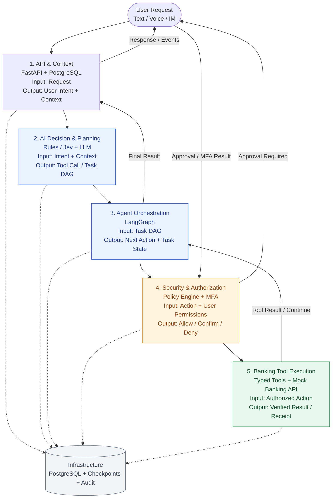

# 首先是当前的架构预期

# 实际工程开发中的文件组织和解耦合
参考
[text](banking_backend_modules.md)
具体的工程细节参考为

# 预计开发顺序
1. Infrastructure + Banking Tools
   先建立可验证的银行模拟环境，让业务操作不依赖 LLM。
2. Security & Authorization
   给所有敏感工具加上真正生效的权限检查。
3. API & Context
   把会话、账户身份、工具和审批流程通过统一 API 接起来。
4. LLM Planner + LangGraph
   让用户通过自然语言生成工具调用，并完成可中断的多步执行。
5. Jev + 高级 Agent 优化
   基于已有测试集判断 Jev 能否降低成本、延迟或改善路由。